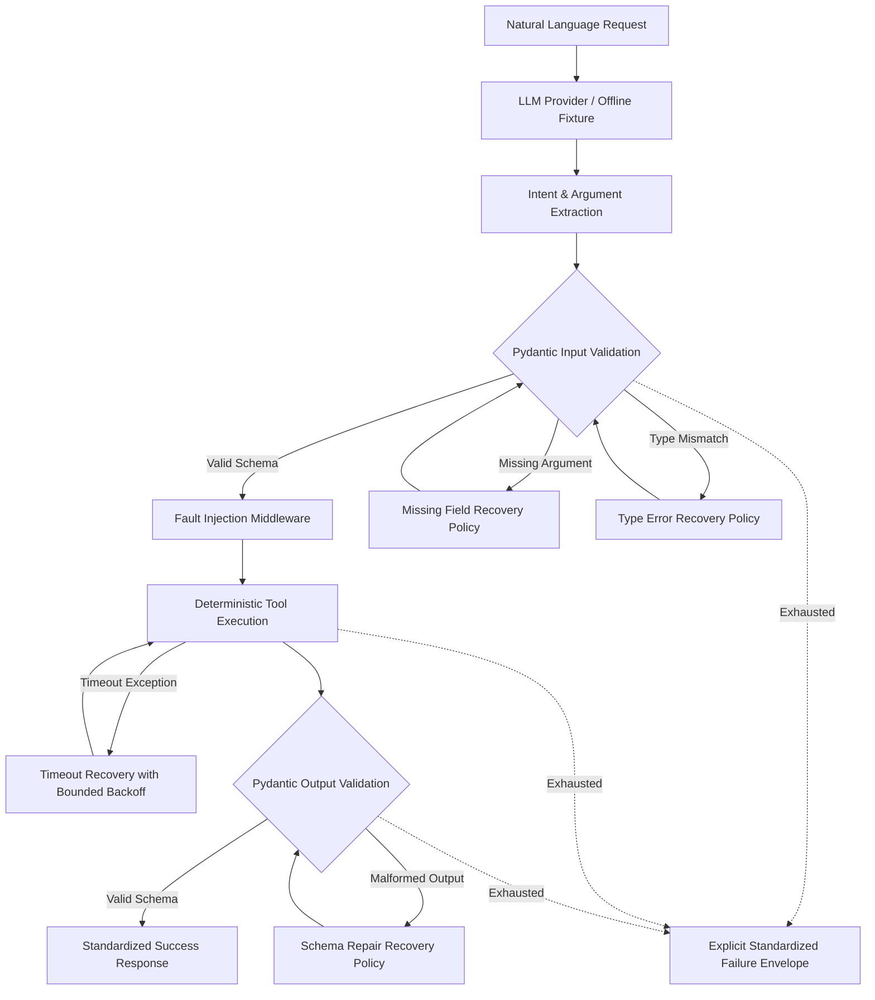

# AI Function-Calling Router

[](https://ai-function-calling-router.vercel.app/)
[](https://www.python.org/)
[](https://fastapi.tiangolo.com)
[](https://docs.pydantic.dev/)
[](https://docs.pytest.org/)
[](https://www.docker.com/)
[](LICENSE)

A high-reliability, production-grade routing engine for translating natural language queries into strictly typed tool calls. Engineered with deterministic fault-injection middleware, request-isolated telemetry, and four targeted recovery policies to eliminate silent execution failures and recover gracefully from edge-case anomalies.

## Live Deployment & Interactive Playground

The project is deployed and live on Vercel with an interactive testing dashboard and full OpenAPI endpoints:

* Live Interactive Web Playground: https://ai-function-calling-router.vercel.app/
* Interactive Swagger OpenAPI Docs: https://ai-function-calling-router.vercel.app/docs
* ReDoc API Reference: https://ai-function-calling-router.vercel.app/redoc
* Health Check Endpoint: https://ai-function-calling-router.vercel.app/api/health
* Route Execution Endpoint: https://ai-function-calling-router.vercel.app/api/route
* Evaluation Metrics Endpoint: https://ai-function-calling-router.vercel.app/api/metrics
* Registered Tools Endpoint: https://ai-function-calling-router.vercel.app/api/tools

The live playground allows you to select preset test scenarios, toggle recovery policies on and off, simulate deterministic timeouts and malformed responses, and view real-time Pydantic validation boundaries and telemetry traces.

## Executive Summary

Traditional LLM tool-calling pipelines frequently suffer from type coercion mistakes, omitted arguments, transient latency spikes, and malformed JSON payloads. In standard production environments, these failures either crash downstream microservices or produce silent corruption.

The AI Function-Calling Router addresses these vulnerabilities through an architecture with strict type boundaries and targeted, bounded recovery mechanisms:

* Strict Type Invariants: Dual Pydantic v2 boundaries validate both inbound tool parameters and outbound tool execution results. Boolean-to-numeric masquerading, empty whitespace strings, and non-finite numbers (NaN/Inf) are rejected before execution.
* Deterministic Fault Injection: ContextVar-scoped middleware simulates real-world infrastructure failures (timeouts, malformed payloads) in a reproducible manner without leaking state across concurrent requests.
* Targeted Recovery Policies: Rather than relying on naive blanket retries, four specialized recovery strategies address missing fields, type errors, timeouts, and malformed schemas with strict attempt bounds.
* 100% Deterministic Offline Evaluation: Comprehensive 60-scenario evaluation harness runs locally without external LLM API costs or token dependencies, delivering reproducible benchmarks.
* Measured Resilience Gain: Elevates completion rates from 58.3% (baseline) to 90.0% (recovery active) while maintaining a 0.0% silent failure rate across the entire evaluation dataset.

## System Architecture

The router organizes execution into a modular, unidirectional pipeline governed by input and output validation gates:



## Architectural Highlights

### 1. Dual-Boundary Pydantic Validation
Both user inputs and tool responses are validated against strict Pydantic v2 models. Extra attributes are forbidden (`extra='forbid'`), boolean types cannot disguise as integers or floats, string dates must adhere strictly to ISO 8601 (`YYYY-MM-DD`), and floats must be finite numbers (`math.isfinite`).

### 2. Isolated Fault Injection Middleware
The fault injector utilizes Python `contextvars.ContextVar` to provide thread-safe, request-local fault simulation. It supports `TIMEOUT` and `MALFORMED_RESPONSE` directives with either `once` or `always` persistence semantics. In-memory counters reset per request, eliminating state leakage across concurrent invocations.

### 3. Targeted Recovery Engine
Instead of indiscriminately repeating failed requests, the router applies targeted recovery policies tailored to the root cause:
* Missing Field Recovery: Identifies missing keys via Pydantic error details, queries the provider for the missing parameter, merges the payload, and re-validates.
* Type Error Correction: Identifies invalid parameter types, prompts for re-formatting or type correction, merges the sanitized parameter, and re-validates.
* Timeout Recovery: Catches transient network or service timeouts, applies a configured exponential backoff, and retries tool invocation without consuming additional LLM provider calls.
* Schema Output Repair: Intercepts corrupted or malformed tool outputs, maps valid attributes, and restores adherence to the tool output contract.

### 4. Deterministic Offline & Live Provider Modes
The engine operates in either offline mode (powered by fixture matching and rule-based extractors for reproducible local evaluation) or live mode (integrating external LLM APIs). This guarantees complete testability in air-gapped CI/CD environments with zero token spend.

## Tool Ecosystem & Contracts

The router includes a registry of four deterministic tools covering diverse validation constraints:

### FlightSearch
* Intent: Query commercial flights between two airport destinations for a specific calendar date.
* Input Contract:
  * `origin`: Non-empty, trimmed string (e.g., "SFO")
  * `destination`: Non-empty, trimmed string (e.g., "JFK")
  * `date`: Strict ISO format date (`YYYY-MM-DD`)
* Output Contract:
  * `status`: Constant literal `"success"`
  * `flight_id`: Deterministic flight identifier (e.g., `"FL-SFO-JFK-101"`)
  * `origin`: Airport origin code
  * `destination`: Airport destination code
  * `date`: Flight date object

### CalendarBooking
* Intent: Schedule calendar events and appointments with strict duration constraints.
* Input Contract:
  * `event_title`: Non-empty, trimmed event title
  * `start_time`: ISO 8601 datetime object
  * `duration_minutes`: Positive integer strictly greater than 0 (boolean inputs rejected)
* Output Contract:
  * `status`: Constant literal `"success"`
  * `booking_id`: Deterministic booking identifier (e.g., `"BK-94812"`)
  * `event_title`: Confirmed event title
  * `start_time`: Confirmed start datetime
  * `duration_minutes`: Confirmed duration in minutes

### WeatherLookup
* Intent: Fetch current temperature and meteorological conditions for a geographic location.
* Input Contract:
  * `location`: Non-empty, trimmed location string
  * `unit`: Enumerated temperature unit (`UnitEnum.C` or `UnitEnum.F`)
* Output Contract:
  * `status`: Constant literal `"success"`
  * `location`: Sanitized location name
  * `temperature`: Finite floating-point reading
  * `unit`: Validated unit enum (`C` or `F`)

### UnitConversion
* Intent: Convert numerical measurements across compatible metric and imperial units.
* Input Contract:
  * `value`: Finite floating-point value (rejects NaN, Inf, and booleans)
  * `from_unit`: Non-empty source unit string
  * `to_unit`: Non-empty target unit string
* Output Contract:
  * `status`: Constant literal `"success"`
  * `original_value`: Original input value
  * `original_unit`: Original source unit
  * `converted_value`: Accurately converted finite float
  * `converted_unit`: Verified target unit

## Recovery Policy Specifications

Every recovery policy conforms to strict bounds to prevent infinite loops, cascade failures, or resource exhaustion:

* Missing Field Policy:
  * Trigger: Pydantic `missing` validation error during inbound parameter check.
  * Invariant: Maximum 1 recovery attempt per request.
  * Escalation: If recovery fails, router outputs `{"status": "error", "reason": "missing_field_unrecoverable"}`.
* Type Error Policy:
  * Trigger: Pydantic type conversion failure during inbound parameter check.
  * Invariant: Maximum 1 correction attempt per request.
  * Escalation: If unresolvable, router outputs `{"status": "error", "reason": "type_error_unrecoverable"}`.
* Timeout Policy:
  * Trigger: Downstream `TimeoutErrorException` emitted by tool execution.
  * Invariant: Exactly 1 retry after bounded backoff; provider is not re-invoked.
  * Escalation: Persistent timeouts yield `{"status": "error", "reason": "timeout_unrecoverable"}`.
* Schema Repair Policy:
  * Trigger: Tool output model validation failure or malformed payload.
  * Invariant: Maximum 1 schema repair pass; aborted if fault directive is persistent (`always`).
  * Escalation: Unrecoverable output yields `{"status": "error", "reason": "schema_repair_unrecoverable"}`.

## Empirical Benchmark & Evaluation

Evaluation is performed over 60 test cases spanning nominal paths, parameter omissions, type corruptions, injected timeouts, and malformed responses.

### Global Performance Metrics

* Baseline Completion Rate: 58.3% (35 of 60 cases successful without recovery)
* Recovery Active Completion Rate: 90.0% (54 of 60 cases successful with recovery enabled)
* Relative Improvement: +54.4% relative gain (+31.7% absolute gain)
* Silent Wrong Rate: 0.0% across both baseline and recovery modes (Zero invalid outputs reached downstream callers)
* Mean Recovery Attempts: 0.383 attempts per case (Minimal compute overhead)

### Per-Tool Completion Comparison

* FlightSearch:
  * Baseline: 50.0%
  * Recovery Active: 88.9%
  * Net Gain: +38.9%
* CalendarBooking:
  * Baseline: 69.2%
  * Recovery Active: 92.3%
  * Net Gain: +23.1%
* WeatherLookup:
  * Baseline: 64.3%
  * Recovery Active: 92.9%
  * Net Gain: +28.6%
* UnitConversion:
  * Baseline: 61.5%
  * Recovery Active: 100.0%
  * Net Gain: +38.5%
* Unknown / Invalid Tools:
  * Correctly rejected with 0.0% false positives, preserving system safety.

## Repository Layout

```
Ai-Function-Calling-Router/
├── .dockerignore                 Docker build exclusions
├── .env.example                  Environment configuration template
├── .gitignore                    Version control ignore rules
├── Dockerfile                    Multi-stage production Dockerfile
├── docker-compose.yml            Docker Compose evaluation service
├── evaluate_router.py            Baseline vs recovery evaluation script
├── generate_dataset.py           Dataset generation utility
├── append_dataset.py             Dataset augmentation helper
├── requirements.txt              Core production and testing dependencies
├── vercel.json                   Vercel serverless deployment routing
├── api/
│   └── index.py                  FastAPI serverless entrypoint and web UI
├── data/
│   └── eval.jsonl                60-case curated evaluation benchmark
├── docs/
│   ├── ARCHITECTURE.md           Detailed system component architecture
│   ├── DOCKER_RUNTIME_AUDIT.md   Container runtime audit and checks
│   ├── FINAL_AUDIT_REPORT.md     Comprehensive verification audit report
│   ├── FINAL_SUBMISSION_CHECKLIST.md Quality checklist
│   ├── RECOVERY_DESIGN.md        Deep dive into recovery algorithms
│   ├── REQUIREMENT_ACCEPTANCE_MATRIX.md Acceptance criteria mapping
│   ├── REQUIREMENT_TRACEABILITY.md  Traceability analysis
│   └── TEST_STRATEGY.md          Testing philosophy and matrix
├── output/
│   ├── dataset_coverage.json     Dataset distribution and SHA-256 hash
│   ├── evaluation_report.json    Full latency and trace metrics report
│   ├── metrics.json              High-level completion and failure metrics
│   ├── per_case_results.jsonl    Granular execution traces per case
│   └── recovery_breakdown.json   Detailed recovery success distribution
├── results/
│   └── traceability.md           Audited requirement verification
├── src/
│   ├── __init__.py               Package marker
│   ├── config.py                 Application configuration and defaults
│   ├── evaluation.py             Evaluation pipeline and metric calculations
│   ├── fault_injector.py         ContextVar fault injection middleware
│   ├── llm_provider.py           Offline and Live provider abstraction
│   ├── recovery.py               Targeted recovery implementations
│   ├── router.py                 Central request routing orchestration
│   ├── schemas.py                Strict Pydantic v2 data models
│   ├── telemetry.py              Request trace and observability dataclass
│   └── tools.py                  Deterministic tool registry and runners
└── tests/
    ├── test_acceptance.py        End-to-end acceptance tests
    ├── test_adversarial.py       Adversarial input and boundary tests
    ├── test_concurrency.py       Context isolation under concurrent calls
    ├── test_contracts.py         Schema contract and envelope verification
    ├── test_dataset.py           Dataset integrity and checksum validation
    ├── test_evaluation.py        Evaluation runner test cases
    ├── test_evaluation_contract.py Benchmark schema validation
    ├── test_fault_injector.py    Fault injection mechanics tests
    ├── test_metrics.py           Metric calculation correctness tests
    ├── test_recovery.py          Individual recovery policy tests
    ├── test_recovery_integration.py Pipeline integration with recovery
    ├── test_recovery_limits.py   Single-attempt guard tests
    ├── test_recovery_missing.py  Missing field recovery tests
    ├── test_recovery_schema.py   Schema repair recovery tests
    ├── test_recovery_timeout.py  Timeout retry and backoff tests
    ├── test_recovery_type.py     Type error recovery tests
    ├── test_router.py            Router workflow tests
    ├── test_schemas.py           Pydantic schema validation tests
    ├── test_semantic_correctness.py End-to-end semantic validation
    ├── test_tool_registry.py     Tool registry registration tests
    └── test_tools.py             Deterministic tool function tests
```

## Getting Started

### Prerequisites

* Python 3.11 or higher
* pip package manager
* Docker and Docker Compose (optional, for containerized runs)

### Local Environment Setup

1. Clone repository:
```bash
git clone https://github.com/Manirider/Ai-Function-Calling-Router.git
cd Ai-Function-Calling-Router
```

2. Create and activate a virtual environment:
```bash
python -m venv .venv
# On Windows:
.venv\Scripts\activate
# On Linux/macOS:
source .venv/bin/activate
```

3. Install project dependencies:
```bash
python -m pip install -r requirements.txt
```

4. Configure environment variables:
```bash
cp .env.example .env
```

Ensure `PROVIDER_MODE=offline` is set in `.env` to execute deterministic benchmarks without third-party API credentials.

### Starting the Local Web Server

Launch the FastAPI interactive playground and REST API locally:

```bash
python -m uvicorn api.index:app --reload --port 8000
```

Navigate to `http://127.0.0.1:8000/` in your browser to access the playground, or `http://127.0.0.1:8000/docs` for the interactive Swagger documentation.

## Running Tests

Execute the comprehensive Pytest suite covering unit, integration, adversarial, and concurrency test suites:

```bash
python -m pytest tests -q
```

Expected result:
```
92 passed in 3.05s
```

## Running the Evaluation Benchmark

Run the automated evaluation harness to compare baseline execution against active recovery:

```bash
python evaluate_router.py
```

The script evaluates all 60 scenarios in `data/eval.jsonl` under both baseline and recovery modes, printing the summary metrics:

```json
{
  "baseline": {
    "completion_rate": 0.5833333333333334,
    "silent_wrong_rate": 0.0,
    "mean_recovery_attempts": 0.0
  },
  "recovery_active": {
    "completion_rate": 0.9,
    "silent_wrong_rate": 0.0,
    "mean_recovery_attempts": 0.38333333333333336
  }
}
```

Generated artifacts are automatically stored in the `output/` directory:
* `output/metrics.json`: High-level completion rates, silent error rates, and mean recovery attempts.
* `output/dataset_coverage.json`: Dataset validation summary, SHA-256 integrity hash, and fault distributions.
* `output/evaluation_report.json`: Detailed execution report containing latency metrics and runtime parameters.
* `output/per_case_results.jsonl`: Step-by-step telemetry trace records for every evaluated scenario.
* `output/recovery_breakdown.json`: Comprehensive distribution of fault classes and recovery activations.

## Docker Containerization

Run the evaluation pipeline within an isolated, reproducible container environment:

1. Validate the compose configuration:
```bash
docker compose config
```

2. Build the Docker image:
```bash
docker compose build --no-cache
```

3. Run the evaluation suite:
```bash
docker compose run --rm evaluator
```

4. Run the automated test suite inside the container:
```bash
docker compose run --rm evaluator pytest -q
```

The host `./output` directory is mounted to `/app/output`, ensuring all generated evaluation reports and metrics persist on your local machine.

## Observability & Telemetry

Every request generates a structured `Trace` record enabling full visibility into the decision path:

* `request_id`: Unique UUID assigned to the incoming query
* `dataset_case_id`: Benchmark identifier for regression testing
* `selected_tool`: Tool selected by intent extraction
* `provider_mode`: `offline` or `live`
* `validation_result`: `valid`, `invalid_input`, `invalid_tool`, or `error`
* `failure_class`: Specific root cause category (`missing_field`, `type_error`, `timeout`, `malformed_response`, `unknown_tool`)
* `recovery_policy`: Policy invoked (`missing_field`, `type_error`, `timeout`, `schema_repair`, or `none`)
* `recovery_attempts`: Number of recovery passes executed (bounded to 0 or 1)
* `tool_execution_attempts`: Number of tool invocations performed
* `provider_call_count`: Total LLM provider requests issued
* `final_status`: Outcome envelope status (`success` or `error`)
* `final_failure_reason`: Stable machine-readable error token if execution failed
* `output_validation_passed`: Boolean flag certifying response integrity
* `duration_ms`: Wall-clock pipeline latency in milliseconds

## Environment Variables Reference

* `PROVIDER_MODE`: Set to `offline` for deterministic local benchmarking or `live` for remote LLM calling. (Default: `offline`)
* `LLM_API_KEY`: Authentication secret for external LLM provider. (Required only when `PROVIDER_MODE=live`)
* `LLM_MODEL_ID`: Model identifier string for live mode operations. (Default: `gpt-4o-mini`)
* `REQUEST_TIMEOUT_SECONDS`: Maximum latency allowance before raising a timeout exception. (Default: `5.0`)
* `RECOVERY_BACKOFF_SECONDS`: Delay duration before re-executing timed-out tools. (Default: `0.05`)
* `EVALUATION_REFERENCE_DATE`: Reference anchor date for relative temporal parsing. (Default: `2025-01-15`)
* `LOG_LEVEL`: Logging verbosity level (`DEBUG`, `INFO`, `WARNING`, `ERROR`). (Default: `INFO`)
* `OUTPUT_DIR`: Target filesystem directory for output reports and metrics. (Default: `output`)

## Invariant Safety Guarantees

1. Zero Silent Failures: No tool call with malformed or unvalidated output is ever returned as successful to the client.
2. Bounded Iterations: Recovery policies enforce hard single-attempt guards; cyclic or infinite retry loops are architecturally impossible.
3. Clean Isolation: Concurrent requests operate within isolated ContextVar frames, preventing cross-request fault or counter corruption.
4. Deterministic Reproducibility: Benchmark runs produce identical SHA-256 metric signatures across diverse runtime environments.

## License

This project is licensed under the MIT License.
