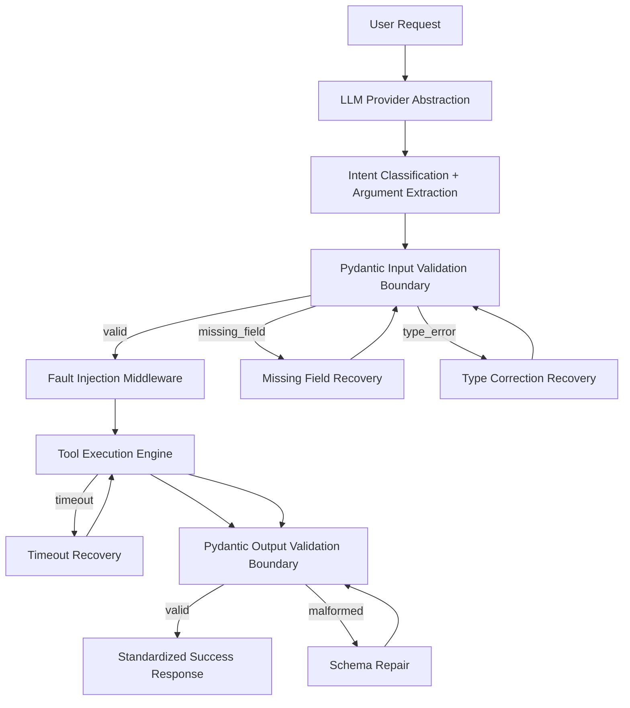

# Architecture - AI Function-Calling Router

## Overview
Modular pipeline for natural language to typed tool calling with deterministic fault injection and targeted recovery.

## Components
1. **Natural Language Request Interface** – `route_request` entry point, accepts request_id, dataset_case_id, request text, fixture.
2. **Intent Classification and Tool Router** – OfflineProvider maps request to tool name using fixture `expected_tool` with heuristic fallback.
3. **LLM Provider Abstraction** – `BaseProvider.extract` returns `ProviderResult(tool_name, args, call_count)`. OfflineProvider is deterministic, no API key required.
4. **Structured Argument Extraction** – OfflineProvider uses `fixture.correct_args` and `initial_argument_fault` to simulate extraction errors.
5. **Pydantic Input Validation Boundary** – Models in `src/schemas.py`. Strict validation rejects bool masquerading as int/float, non-finite values, invalid dates.
6. **Tool Registry** – `src/tools.py TOOL_REGISTRY` maps name → input_model, output_model, func, description.
7. **Fault Injection Middleware** – `src/fault_injector.py` ContextVar based, per-request counters, supports NONE, TIMEOUT, MALFORMED_RESPONSE with once/always persistence.
8. **Tool Execution Engine** – `_run_tool` applies fault injector then validates output via output model.
9. **Targeted Recovery Engine** – `src/recovery.py` four independent policies with attempt guards via `RecoveryContext`.
10. **Pydantic Output Validation Boundary** – Immediate validation after execution; failures trigger schema repair.
11. **Standardized Response Handler** – Success envelope `{status:"success", data:{...}}`, Failure envelope `{status:"error", reason:...}` with stable reason strings.
12. **Structured Logging and Observability** – `src/telemetry.py Trace` dataclass captures request_id, selected_tool, provider_mode, validation_result, failure_class, recovery_policy, recovery_attempts, tool_execution_attempts, provider_call_count, final_status, final_failure_reason, output_validation_passed, duration_ms.
13. **Evaluation Harness** – `evaluate_router.py` runs dataset twice baseline vs recovery, computes completion_rate, silent_wrong_rate, mean_recovery_attempts, writes atomic `output/metrics.json`.
14. **Docker Execution Environment** – Python 3.11 slim, pinned requirements, offline mode default, output mounted to host.

## Data Flow
Request → Provider extract → Input validation → Fault inject → Tool exec → Output validation → Response
Recovery paths re-enter at validation or execution with bounded attempts.

## Non-Functional
- Deterministic offline mode, no paid API
- Request-scoped state via ContextVar, no leakage
- No generic retry loops, targeted policies only
- All counters derived from actual events
