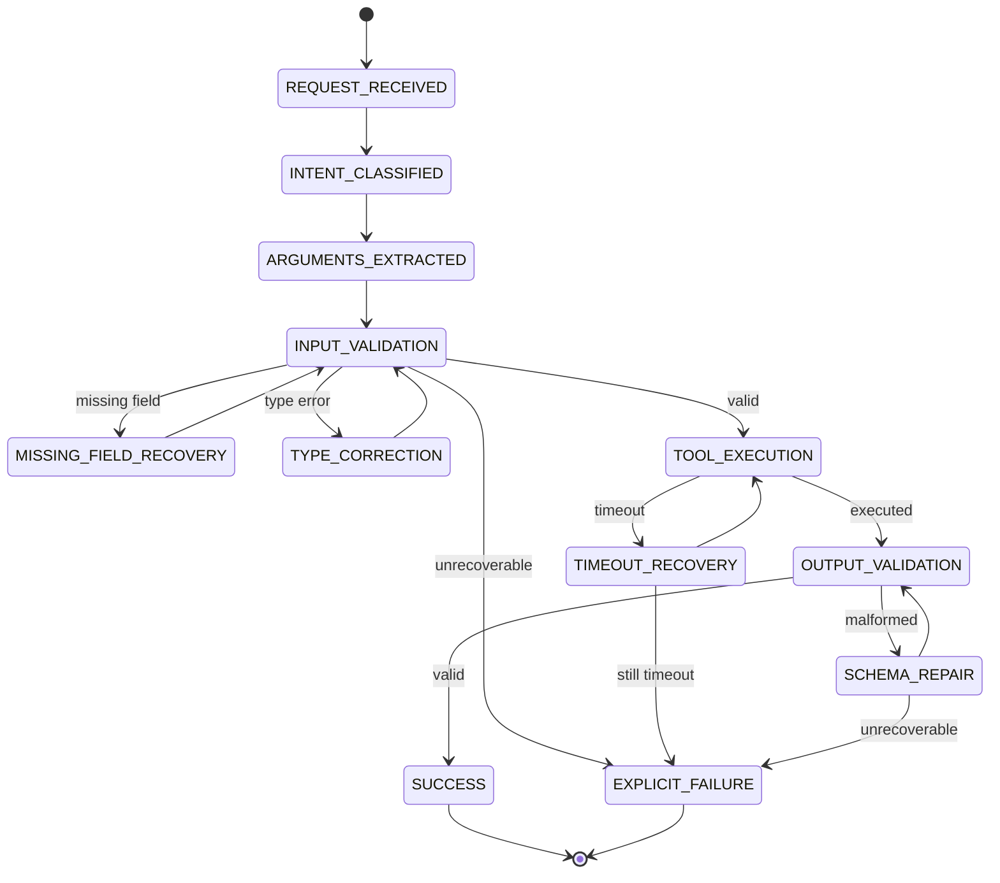

# Recovery Design

## State Machine

## States
- REQUEST_RECEIVED
- INTENT_CLASSIFIED
- ARGUMENTS_EXTRACTED
- INPUT_VALIDATION
- MISSING_FIELD_RECOVERY
- TYPE_CORRECTION
- TOOL_EXECUTION
- TIMEOUT_RECOVERY
- OUTPUT_VALIDATION
- SCHEMA_REPAIR
- SUCCESS
- EXPLICIT_FAILURE

## Transitions
Valid transitions enforce single attempt per class. No loops beyond one recovery attempt.

## Policies

### Missing Field
- Trigger: Pydantic ValidationError type `missing`/`missing_required_field`
- Action: Build narrow prompt with tool name, missing field, expected type, original request. Offline simulation merges field from fixture `correct_args`.
- Max attempts: 1
- Success: revalidate input model
- Failure: `{"status":"error","reason":"missing_field_unrecoverable"}`

### Type Error
- Trigger: ValidationError not missing
- Action: Correct specific field using fixture correct value
- Max attempts: 1
- Failure: `type_error_unrecoverable`

### Timeout
- Trigger: `TimeoutErrorException` from FaultInjector
- Action: Bounded backoff `Config.RECOVERY_BACKOFF_SECONDS`, retry same tool call once, no provider call
- Provider call count must remain unchanged
- Max attempts: 1
- Failure: `timeout_unrecoverable`

### Schema Repair
- Trigger: Output validation fails
- Action: Repair provider receives malformed payload and expected schema, maps evidence only. Offline simulation re-executes tool without fault injection; persistent faults return None.
- Max attempts: 1
- Failure: `schema_repair_unrecoverable`

## Invariants
- One recovery attempt per failure class per request
- Timeout recovery never calls LLM
- Missing-field recovery only adds missing value, preserves valid fields
- Type correction only replaces rejected field
- Schema repair cannot invent identifiers, measurements, dates
- Concurrent requests isolated via ContextVar
- All attempts measurable via Trace
- Persistent failures terminate explicitly, never fabricate success
