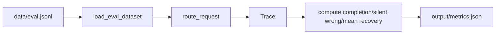

# Test Strategy

## Unit Tests
- Schema validation: valid inputs, missing fields, wrong types, invalid dates, enum violations, non-finite numbers, bool rejection.
- Fault injector: NONE preserves behavior, TIMEOUT raises once/always, MALFORMED returns invalid payload, isolation between tools, counters reset per request.
- Recovery functions: missing field merge, type correction merge, schema repair success/unrecoverable, attempt guards.

## Integration Tests
- Happy path succeeds with zero recovery.
- Missing field recovery end-to-end.
- Type error recovery end-to-end.
- Timeout recovery with no additional provider call, tool execution attempts = 2.
- Malformed response repair end-to-end.
- Unknown tool fails safely.
- Persistent faults produce explicit failure reasons.
- Output validation enforced before success.

## Contract Tests
- Metrics JSON structure and value ranges.
- Dataset load, checksum stability, ≥60 cases.
- Baseline mode has zero recovery attempts.
- Completion rate improves with recovery on recoverable faults.
- Silent wrong rate zero.
- Recovery attempts bounded.

## Evaluation Pipeline


## Determinism
- OfflineProvider uses fixture hints, no randomness.
- Fault injector deterministic via persistence flags.
- Reference date fixed via Config.EVALUATION_REFERENCE_DATE.
- No network calls in tests.

## Execution
```bash
pytest tests -q
python evaluate_router.py
```
